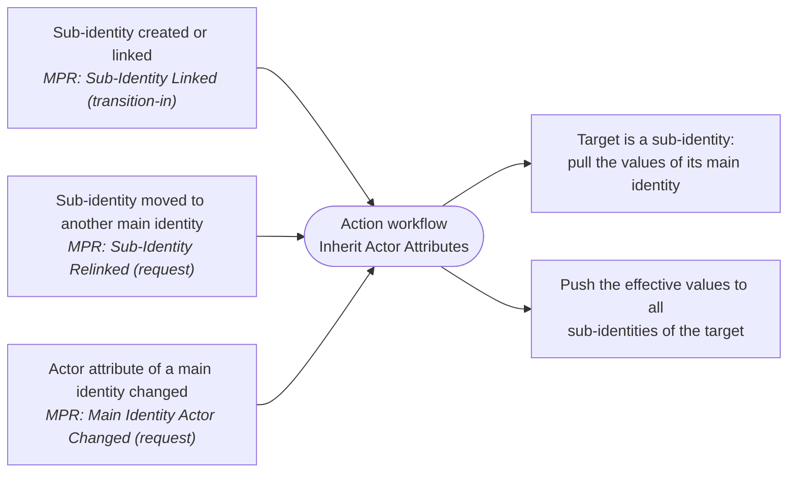

# MIM Actor Inheritance Workflow

A Microsoft Identity Manager (MIM) 2016 action workflow that keeps **sub-identities** in line with their
**main identity**. Every sub-identity inherits the actor attributes of the main identity it references, and
keeps inheriting them when those attributes change.

- Custom workflow activity **Actor Inheritance**, configurable in the MIM Portal workflow designer.
- Idempotent PowerShell deployment of the activity registration, sets, workflow and MPRs.
- A drift report that lists sub-identities whose attributes differ from their main identity.

## Data model

```
Sub-identity (Person)                        Main identity (Person)
  MainIdentity ───────── reference ─────────►  ObjectID
  Actor        ◄──────── inherited ──────────  Actor
  <further inherited attributes>  ◄──────────  <further inherited attributes>
```

| Setting | Default | Meaning |
|---|---|---|
| `IdentityObjectType` | `Person` | Object type of main and sub-identities |
| `MainIdentityAttribute` | `MainIdentity` | Single-valued reference on the sub-identity that points to its main identity |
| `InheritedAttributes` | `Actor` | Actor attributes copied from the main identity. Any data type, single- or multi-valued |

Change them in [`deploy/ActorInheritance.config.psd1`](deploy/ActorInheritance.config.psd1) to match your schema.

## How it works



The deployment creates these MIM objects (display name prefix `Actor Inheritance`):

| Object | Definition |
|---|---|
| Set `Sub-Identities` | `/Person[MainIdentity = /Person]` |
| Set `Main Identities` | `/Person[ObjectID = /Person/MainIdentity]` (identities that have at least one sub-identity) |
| Workflow `Inherit Actor Attributes` | Action workflow with the Actor Inheritance activity |
| MPR `Sub-Identity Linked` | Set transition into *Sub-Identities*. Covers creation, first link and the initial load |
| MPR `Sub-Identity Relinked` | Request: *Modify* `MainIdentity` on a member of *Sub-Identities* |
| MPR `Main Identity Actor Changed` | Request: *Add/Remove/Modify* of an inherited attribute on a member of *Main Identities* |

The activity works out the direction from the request target:

1. It reads the target. If the target references a main identity, it reads the main identity, and the main
   identity's values become the *effective values*. Otherwise the target's own values are the effective values.
2. If the target is a sub-identity, it is aligned with the effective values (pull).
3. All identities that reference the target as main identity are enumerated and aligned too (push).
4. Only real differences are written: `Modify` or `Remove` for single-valued attributes, `Insert` or `Remove`
   per value for multi-valued ones. There is one update request per changed resource.

Behaviour worth knowing:

- **Runs as the FIM Service Account.** It needs no additional permission MPRs, and it works for requests from
  the Portal, from the synchronization engine and from other workflows (requestor set: `All People`).
- **Idempotent.** Running it again changes nothing. Cycles (A → B → A) settle after one round.
- **Chains cascade.** If a sub-identity is itself the main identity of others, its update triggers the next
  level through the *Main Identity Actor Changed* MPR.
- **Clearing propagates.** A value removed from the main identity is removed from its sub-identities.
- **Unlinking keeps values.** Removing `MainIdentity` from a sub-identity leaves its current values as they are.
- **The main identity is authoritative.** A direct edit of an inherited attribute on a sub-identity is
  overwritten at the next trigger. Make the fields read-only in the sub-identity RCDC or deny them with an MPR
  if needed.
- **Synchronization.** Do not also flow the inherited attributes into sub-identities from a connected system,
  or the synchronization engine and the workflow will overwrite each other.

## Repository layout

```
├── ActorInheritance.sln
├── deploy/
│   ├── ActorInheritance.config.psd1          # environment configuration
│   ├── ActorInheritance.Fim.ps1              # FIMAutomation helpers (dot-sourced)
│   ├── Build-ActorInheritance.ps1            # build + strong name key
│   ├── Install-ActorInheritanceActivity.ps1  # GAC install + service restart (every Service/Portal server)
│   ├── Deploy-ActorInheritancePolicy.ps1     # activity registration, sets, workflow, MPRs (once)
│   └── Test-ActorInheritance.ps1             # drift report
├── lib/                                      # MIM reference assemblies (not in git)
├── src/MIM.ActorInheritance.Workflow/
│   ├── ActorInheritanceActivity.cs           # the workflow activity
│   ├── ActorInheritanceActivitySettingsPart.cs # Portal designer UI
│   ├── InheritanceCalculator.cs              # MIM independent change calculation
│   ├── AttributeChange.cs                    # serializable change model
│   └── ResourceValues.cs                     # MIM value conversion
└── tests/MIM.ActorInheritance.Workflow.Tests/ # unit tests (no MIM needed)
```

## Prerequisites

- MIM 2016 (SP2 or later) Service and Portal.
- Windows PowerShell 5.1 with the `FIMAutomation` snap-in, run by a member of the MIM *Administrators* set.
- Build: the .NET SDK, or Visual Studio 2017+ / Build Tools with the .NET Framework 4.6.2 targeting pack.
- MIM reference assemblies `Microsoft.ResourceManagement.dll` and `Microsoft.IdentityManagement.WebUI.Controls.dll`.
  The build script copies them from the GAC when it runs on a MIM server that has both the Service and the Portal
  installed. Otherwise copy them into `lib/` yourself.
- Schema: `MainIdentity` must be a single-valued reference attribute bound to `Person`. The deploy script can
  create it with `-CreateMainIdentityAttribute`. The inherited attributes must already exist and be bound to `Person`.

## Deployment

1. **Configure** `deploy/ActorInheritance.config.psd1`: object type, main identity attribute and inherited attributes.

2. **Build**
   ```powershell
   .\deploy\Build-ActorInheritance.ps1
   ```
   The first build creates `ActorInheritance.snk`. Keep it (commit it or store it safely). The assembly's
   PublicKeyToken is derived from it and is registered in MIM.

3. **Install** on every MIM Service server and every MIM Portal server, from an elevated prompt. This restarts
   `FIMService` and IIS.
   ```powershell
   .\deploy\Install-ActorInheritanceActivity.ps1
   ```

4. **Deploy the MIM configuration.** Run this once, on a MIM Service server. Review the changes first:
   ```powershell
   .\deploy\Deploy-ActorInheritancePolicy.ps1 -WhatIf
   .\deploy\Deploy-ActorInheritancePolicy.ps1               # add -CreateMainIdentityAttribute if needed
   ```
   With `RunOnPolicyUpdate = $true`, creating the *Sub-Identity Linked* MPR runs the workflow for every existing
   sub-identity. That is the initial load. The script is idempotent: re-running it only changes what differs
   from the configuration.

5. **Verify** once the requests are processed (Portal → *Search Requests*):
   ```powershell
   .\deploy\Test-ActorInheritance.ps1 | Format-Table -AutoSize
   ```
   An empty result means every sub-identity matches its main identity.

## Changing the configuration

- **Inherited attributes, attribute or object type names:** edit the config and re-run
  `Deploy-ActorInheritancePolicy.ps1`. It updates the workflow XOML and the MPRs in place.
- **Code changes:** rebuild, then re-run `Install-ActorInheritanceActivity.ps1` on all servers. The assembly
  version stays `1.0.0.0`, so the GAC copy is replaced in place.
- **New strong name key:** rebuild, reinstall, then re-run the deploy script. It updates the registered assembly
  name and the XOML.

The activity can also be added to other action workflows in the Portal: *Workflows → Add Activity →
Actor Inheritance*.

## Troubleshooting

- **Request ends in `PostProcessingError`:** open the request in *Search Requests* and check the workflow
  instance details. Configuration errors are reported as
  `The actor inheritance activity is misconfigured: …`.
- **Activity missing in the Portal designer:** check the assembly is in the GAC of the Portal server, run
  `iisreset`, and check the *Actor Inheritance* activity registration (`ActivityInformationConfiguration`).
- **Tracing:** the activity writes to the trace source `MIM.ActorInheritance`. To enable it, add this to
  `Microsoft.ResourceManagement.Service.exe.config` under `<system.diagnostics><sources>` and restart `FIMService`:
  ```xml
  <source name="MIM.ActorInheritance" switchValue="Information">
    <listeners>
      <add name="ActorInheritanceLog" type="System.Diagnostics.TextWriterTraceListener"
           initializeData="C:\Logs\MIM.ActorInheritance.log" />
    </listeners>
  </source>
  ```
  Also add `<trace autoflush="true" />` inside `<system.diagnostics>`.

## Tests

The change calculation does not depend on MIM, so its unit tests run anywhere the .NET SDK is installed:

```bash
dotnet test tests/MIM.ActorInheritance.Workflow.Tests
```

## Removal

Disable or delete the three MPRs, then delete the workflow, the two sets and the *Actor Inheritance* activity
registration. Remove the assembly from the GAC on all servers (`gacutil /u MIM.ActorInheritance.Workflow`), then
restart `FIMService` and IIS.

---
Author: N.Stillhart · 2026-09-28
